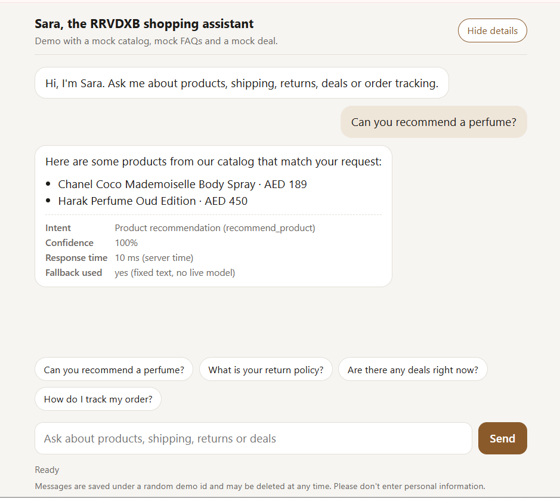
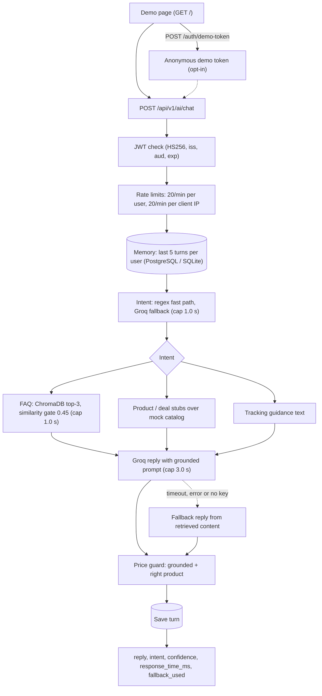

# RRVDXB AI Shopping Chatbot

FastAPI backend for an e-commerce shopping assistant: it answers FAQs from a ChromaDB index, recommends products and deals, and replaces any reply that quotes a price that is not in its data.

Built during my TechNexus internship for a real client (RRVDXB e-commerce); published with permission.


## Live demo

Live demo: deploying this week (link coming soon).

The first request after a quiet period may be slow while the service starts.



## What it does

A shopper asks the assistant about products, deals, delivery, returns or order tracking. The backend works out the intent (a regex fast path first, an LLM only for unclear messages), looks up FAQ answers in a local ChromaDB index or products and deals in the catalog, and asks a Groq-hosted LLM to answer using only that context. A price guard then checks every price in the reply; a price that is not in the data, or that belongs to a different product, makes the reply be replaced by a safe message. Without a Groq key, or if Groq is slow or fails, the API returns a fixed fallback reply built from the retrieved content.

## Key features

- **JWT authentication:** `POST /api/v1/ai/chat` needs `Authorization: Bearer <token>`. HS256 only; `sub`, `iat`, `exp`, `iss` and `aud` are required. Bad, expired, `alg=none` or wrong-issuer tokens get the same 401. The app refuses to start with a secret shorter than 32 characters (outside `APP_ENV=test`).
- **Opt-in demo tokens:** `POST /api/v1/auth/demo-token` (off by default, 404 when off) issues an anonymous 30-minute token and allows 5 per client IP per minute. It exists so the public demo page needs no accounts.
- **Per-user isolation:** the user id is the token's `sub`. Chat memory (last 5 turns) is per user, and the 20 requests per minute limit is keyed on the verified user, not on a header.
- **Price guard:** after every LLM reply, on all reply paths, each price must (1) appear in what the model saw that turn and (2) match the price and currency of the catalog product named next to it. It recognises AED, USD, SAR, GBP, PKR, INR, `Rs`, `₨`, `₹`, `$`, `£` and "dirham(s)". Limits: the per-product check is a heuristic (nearest product name before the price in the same sentence); bare numbers, prices written before the product name and paraphrased product names are not checked; calculated or converted prices are replaced; only prices are checked, not other facts.
- **Hybrid intent with real confidence:** five intents. A regex fast path costs no LLM call; unclear messages go to a Groq classifier. The API reports the classifier's own confidence; below 0.7 the intent becomes `general_chat`, and a failed or timed-out classification reports 0.0.
- **Request time budget:** one 4.0 s budget per chat request. Intent (cap 1.0 s), FAQ retrieval (cap 1.0 s) and the reply call (cap 3.0 s) run in worker threads and each gets its cap or the time left, whichever is smaller. History load and save are outside the budget.
- **Deterministic fallback replies:** on a timeout, an API error or a missing key, the reply is fixed text built from the retrieved FAQ answer, products, deal or tracking guidance (or a "nothing found" message with a human-support offer), still passed through the price guard. `fallback_used` tells the client.
- **PostgreSQL and SQLite with Alembic:** SQLAlchemy 2.0-style models, psycopg 3, migration `0001` creates `chat_history`, run at start-up when `DB_AUTO_MIGRATE=true`. The DB tests run on SQLite and on PostgreSQL 16.
- **ChromaDB retrieval:** 12 FAQ chunks embedded locally with `all-MiniLM-L6-v2`, top 3, cosine similarity gate (`RAG_SIMILARITY_THRESHOLD`, default 0.45). The model and index are loaded and queried at start-up; `/health` reports `rag_ready`.
- **Logging privacy:** tests capture the logs and check that raw user messages, API-key text, tokens and SQL parameters do not appear. Log lines record message length only.
- **Proxy-aware rate limits:** with `TRUST_PROXY`, the client IP is the right-most `X-Forwarded-For` entry (spoofed left entries are ignored). It feeds the demo-token limit and a per-IP chat cap (20 per minute) on top of the per-user limit.
- **Demo page** at `GET /`: example questions, a typing indicator, a "Show details" panel (intent, confidence, response time, fallback used), a mobile layout and right-to-left text in bubbles (`dir="auto"`). A strict hash-based CSP, and the token is kept in a JavaScript variable only. I checked it in a browser at desktop and phone sizes; the JavaScript itself is not covered by automated tests.
- **Docker:** CPU-only PyTorch, non-root user (uid 1000), model and index baked into the image and Hugging Face offline at runtime, `docker-compose.yml` with an optional PostgreSQL profile. GitHub Actions CI: blocking ruff, tests with a 92% coverage gate, and a PostgreSQL job; no API key.

## Architecture



## Engineering decisions

- **Hand-rolled orchestration, no LangChain.** The pipeline is classify, retrieve, generate, check. Keeping it in `chatbot_service.py` makes the timeouts, fallbacks and guard explicit.
- **Deterministic price guard.** Prices are the facts a shopper acts on, so they are checked in code against the data, not left to the prompt. A failed check replaces the whole reply, and only the safe text is saved to memory.
- **One time budget, every blocking step bounded.** Each step has a cap and a fallback, so a slow dependency degrades the answer instead of hanging the request.
- **No LLM in tests or CI.** Groq is mocked, so the suite runs without a key and without cost.
- **Identity from the token, never from a header.** A spoofed `X-User-Id` is ignored; limits and memory use the verified `sub`.
- **Container built to start offline.** The embedding model and index are baked in, so the container needs no network at runtime.
- **Alembic instead of `create_all`.** The schema is versioned and tested on both databases (autogenerate diff empty, upgrade, downgrade, upgrade again).

## Results

Tests, coverage, lint, the retrieval evaluation and the Docker figures were measured on 2026-11-08 (Windows 11 host; tests and the container ran in Linux Docker; no API keys). The Docker figures come from a local run of the final image, not from a hosted demo.

| Area | Result |
|---|---|
| Tests | 360 passed, 1 skipped (the TLS PostgreSQL test), no API key needed (LLM mocked) |
| Coverage | 94.44% line coverage (1098 statements, 61 missed); no files omitted; CI fails below 92% |
| Lint | `ruff check .` passes |
| PostgreSQL | the `-m db` tests: 195 passed, 1 skipped on a temporary PostgreSQL 16 container |
| Retrieval, dev set | gated hit@1 0.67, hit@3 0.67, MRR@3 0.67; 7 of 7 off-topic rejected (30 + 7 questions) |
| Retrieval, held-out set | gated hit@1 0.80, hit@3 0.87, MRR@3 0.83; 6 of 10 off-topic rejected (15 + 10 questions) |
| Docker image | 2.64 GB on disk; PyTorch `2.15.0+cpu`, no CUDA; no test tools in the image |
| Docker runtime | runs as uid 1000; 5.9 s from `docker run` to the first `/health` 200 (image already on disk); 407 MiB RAM after one chat |
| Live latency (p50 / p95) | to be measured after deployment |

Hosted-deployment numbers (cold start, memory under traffic, live Groq latency, answer quality) are unmeasured.

## How the retrieval threshold was chosen

The similarity gate was 0.60 and rejected many real questions. I measured it with `scripts/eval_retrieval.py` (no LLM, no key; it builds a fresh index in a temp directory):

1. **Dev set** (`data/eval/retrieval_eval.jsonl`): 30 in-scope paraphrases and 7 off-topic questions. I used it to pick the threshold. Gated hit@1 went from 0.40 (at 0.60) to 0.67 (at 0.45); off-topic rejection stayed 7/7.
2. **Held-out set** (`data/eval/retrieval_heldout.jsonl`): 15 in-scope and 10 off-topic questions, several of them near-topic (other shops, cities, unrelated deliveries). I wrote it before measuring and did not edit it afterwards. At 0.45 gated hit@1 is 0.80 (0.33 at 0.60), but off-topic rejection falls from 9/10 to 6/10.
3. **Raw ranking** with no threshold: hit@1 1.00 on dev and 0.93 on held-out (one miss: "Do you ship within Sharjah?" ranks the KSA FAQ above the UAE FAQ).

**Four near-topic questions still pass the gate at 0.45:**

| Question | Similarity |
|---|---|
| "Does Amazon deliver to Riyadh?" | 0.648 (it also passed 0.60) |
| "How much is a flight from Karachi to Lahore?" | 0.583 |
| "How long does Noon take to refund an order?" | 0.455 |
| "Is the Dubai metro running late tonight?" | 0.454 |

Questions that name a city, a delivery or a refund score like real customer questions, so no single threshold separates them here. As a second line of defence the reply prompt has a scope rule (answer only about RRVDXB; decline other companies, travel, transport and unrelated topics). A test checks the rule is in the prompt on every reply path, but **whether the live model follows it is not measured**. Both sets are written by the project author, not real traffic, and are small (45 in-scope, 17 off-topic), so the numbers are indicative. Details: [data/eval/README.md](data/eval/README.md).

## Run locally

Requires Python 3.11 (the version CI uses).

```bash
git clone https://github.com/ameema28/rrvdxb-ai-chatbot.git
cd rrvdxb-ai-chatbot
python -m venv .venv
source .venv/bin/activate          # Windows: .venv\Scripts\activate
pip install -r requirements.txt
cp .env.example .env               # Windows: copy .env.example .env
```

Edit `.env`: set `INTERNAL_JWT_SECRET` (at least 32 characters; the app will not start without it) and, optionally, `GROQ_API_KEY` for live answers. For the demo page also set `DEMO_TOKENS_ENABLED=true`. To generate a secret (same command in bash and PowerShell), then paste it into `.env`:

```bash
python -c "import secrets; print(secrets.token_urlsafe(48))"
```

Start the server:

```bash
uvicorn app.main:app --reload
```

The first start downloads the embedding model (about 90 MB, needs internet) and builds the FAQ index automatically; later starts reuse them. The index is also built by `python scripts/build_vector_store.py`, but running it is optional.

On Linux, to avoid the large default PyTorch download, install the CPU build first: `pip install torch==2.15.0 --index-url https://download.pytorch.org/whl/cpu`.

Open http://127.0.0.1:8000/ for the demo page or http://127.0.0.1:8000/docs for Swagger UI. Without a Groq key every reply is the fallback reply built from retrieved content (`fallback_used: true`).

**With Docker Compose:**

```bash
docker compose up -d --build     # http://localhost:8000
docker compose down
```

`INTERNAL_JWT_SECRET` (and optionally `GROQ_API_KEY`) come from your own `.env`; compose enables demo tokens. History is kept in a named volume. For a local PostgreSQL, set `COMPOSE_DATABASE_URL=postgresql://postgres@db:5432/postgres` in your shell (bash: `export ...`; PowerShell: `$env:COMPOSE_DATABASE_URL = "..."`) and run `docker compose --profile postgres up -d --build`.

**Try the API** (demo tokens enabled):

```bash
TOKEN=$(curl -s -X POST http://localhost:8000/api/v1/auth/demo-token | python -c "import sys,json; print(json.load(sys.stdin)['access_token'])")
curl -s -X POST http://localhost:8000/api/v1/ai/chat \
  -H "Authorization: Bearer $TOKEN" -H "Content-Type: application/json" \
  -d '{"message": "What is your return policy?"}'
```

```powershell
$t = (Invoke-RestMethod -Method Post http://localhost:8000/api/v1/auth/demo-token).access_token
Invoke-RestMethod -Method Post http://localhost:8000/api/v1/ai/chat -Headers @{Authorization="Bearer $t"} -ContentType "application/json" -Body '{"message":"What is your return policy?"}'
```

| Method | Path | Description |
|---|---|---|
| `GET` | `/` | Demo chat page |
| `GET` | `/health` | `status` (`ok` or `degraded`), service name, `rag_ready` |
| `POST` | `/api/v1/auth/demo-token` | Anonymous demo token (`access_token`, `token_type`, `expires_in`); 404 unless `DEMO_TOKENS_ENABLED=true` |
| `POST` | `/api/v1/ai/chat` | Bearer token required. Body `{"message": "..."}`. Reply: `reply`, `recommended_products`, `deal`, `intent`, `confidence`, `response_time_ms`, `fallback_used` |
| `GET` | `/docs`, `/redoc` | Swagger UI, ReDoc |

Errors use one JSON shape, `{error, detail, status_code}`; a 429 carries `Retry-After: 60`.

### Environment variables

| Variable | Default | Meaning |
|---|---|---|
| `INTERNAL_JWT_SECRET` | none (required) | HS256 signing secret, at least 32 characters (only `APP_ENV=test` skips the check) |
| `GROQ_API_KEY` | empty | Groq key. Empty means every reply is the fallback reply |
| `LLM_MODEL` | `llama-3.1-8b-instant` | Groq model name |
| `APP_ENV` | `production` | `development`, `test` or `production` |
| `DATABASE_URL` | `sqlite:///./rrvdxb.db` | SQLite or PostgreSQL (`postgres://`, `postgresql://`; psycopg 3) |
| `DB_AUTO_MIGRATE` | `true` | Run `alembic upgrade head` at start-up |
| `JWT_ISSUER`, `JWT_AUDIENCE` | `rrvdxb-chatbot`, `rrvdxb-chat` | Required `iss` and `aud` claims |
| `DEMO_TOKENS_ENABLED` | `false` | Expose the demo-token endpoint |
| `DEMO_TOKEN_TTL_SECONDS`, `DEMO_TOKEN_RATE_PER_MINUTE` | `1800`, `5` | Demo token lifetime; tokens per client IP per minute |
| `RATE_LIMIT_PER_MINUTE` | `20` | Chat requests per verified user per minute |
| `CHAT_IP_RATE_PER_MINUTE` | `20` | Chat requests per client IP per minute |
| `TRUST_PROXY`, `TRUST_PROXY_HOPS` | `false`, `1` | Read the client IP from `X-Forwarded-For` (only behind a proxy that appends it); which entry from the right |
| `REQUEST_BUDGET_SECONDS` | `4.0` | Total time budget per chat request |
| `INTENT_TIMEOUT_SECONDS`, `RETRIEVAL_TIMEOUT_SECONDS`, `LLM_TIMEOUT_SECONDS` | `1.0`, `1.0`, `3.0` | Caps for intent, retrieval and the reply call |
| `RAG_SIMILARITY_THRESHOLD` | `0.45` | Minimum cosine similarity for an FAQ chunk |
| `RAG_WARMUP` | `true` | Load the model and index at start-up |
| `LOG_LEVEL` | `INFO` | Root log level |
| `DEBUG` | `false` | FastAPI debug mode |
| `PORT` | `8080` in the Docker image | Port the container listens on |

## Testing

No API key is needed: every LLM call is mocked.

```bash
pip install -r requirements-dev.txt
pytest -p no:cacheprovider --cov=app
ruff check .
```

`pytest -m db` runs only the database tests; set `TEST_DATABASE_URL` (for example `postgresql+psycopg://postgres@localhost:5432/postgres`) to run them against PostgreSQL as well.

**Docker option (for example on Windows, if installing PyTorch locally is a problem):** run the suite in the project image. From the repository root, replace `<absolute path to the repo>`:

```bash
docker build -t rrvdxb-ai-chatbot .
docker run --rm --user root -v "<absolute path to the repo>:/src:ro" --entrypoint bash rrvdxb-ai-chatbot -c "mkdir /tmp/w && cd /src && tar --exclude=.env --exclude=.git --exclude=.venv -cf - . | tar -xf - -C /tmp/w && cd /tmp/w && pip install -q -r requirements-dev.txt && python -m pytest -p no:cacheprovider -q --cov=app"
```

The repository is mounted read-only and copied inside the container without `.env`, so nothing is written to your checkout. The test tools are installed in the container only (needs internet).

Scripts in `scripts/` (no key needed) work against any running URL: `smoke_check.py --url <URL> --out <file>` (health, demo page, the four example questions, price-guard probe, rate limits, scope probes), `benchmark.py --url <URL> --out <file>` (sequential latency, p50/p95), and `eval_retrieval.py` (the evaluation above). Output files must be outside the repository.

## Deployment

See [DEPLOYMENT.md](DEPLOYMENT.md) for Cloud Run settings, secrets, variables, the post-deploy checks and known limits. Engineering notes: [docs/chatbot.md](docs/chatbot.md) (Part 1 is the current state; Part 2 is a historical build log).

## Limitations

- **Not deployed yet.** Cold start, memory under real traffic, live Groq latency and answer quality are unmeasured. "Bounded by a 4.0 s budget" is a design limit, not a measured response time.
- **Live model behaviour is unverified.** The prompt rules (plain text, no duplicate lists, quote prices as given, stay on RRVDXB) are tested for presence in the prompt, not for being followed.
- **Price guard is a heuristic.** It checks prices only (see Key features for what it misses).
- **Off-topic questions can pass retrieval.** 4 of 10 held-out off-topic questions pass the gate (see above).
- **Mock data.** 10 products, 12 FAQs; recommendations and deals are keyword-matching stubs, and the deal is always the same offer. Order tracking returns guidance text, not real order data.
- **Anonymous demo tokens, no accounts.** Authentication verifies tokens; there is no user registration or login.
- **Single process.** The rate limiter is in memory and per process; with N instances the effective limit is N times higher.
- **History load/save is outside the time budget.**
- **Hosted demo history is temporary.** SQLite lives on the container's disk and is lost on redeploy unless `DATABASE_URL` points to PostgreSQL.
- **Large image.** 2.64 GB (PyTorch and its dependencies); building from scratch was slow (the model-download layer was the slowest step I measured).
- **Older FastAPI, Starlette and Uvicorn versions** are pinned and have not been scanned for vulnerabilities (see DEPLOYMENT.md).
- **Evaluation sets are small and written by the author.** Retrieval only; no answer-quality evaluation.

## Credits

Built by Ameema Rashid during the TechNexus internship for RRVDXB. Published with permission for portfolio purposes. All rights reserved.
